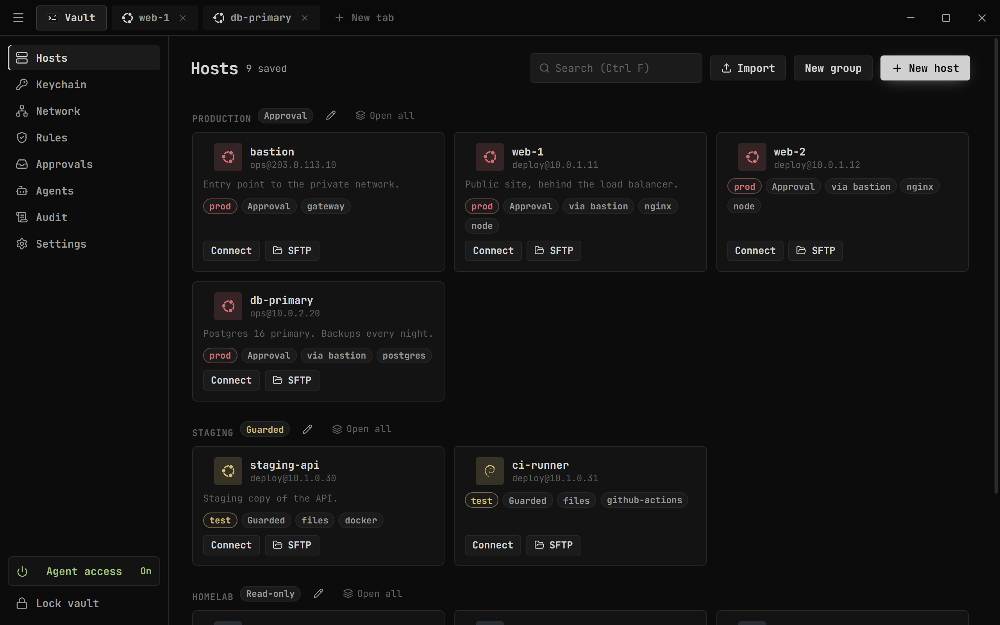
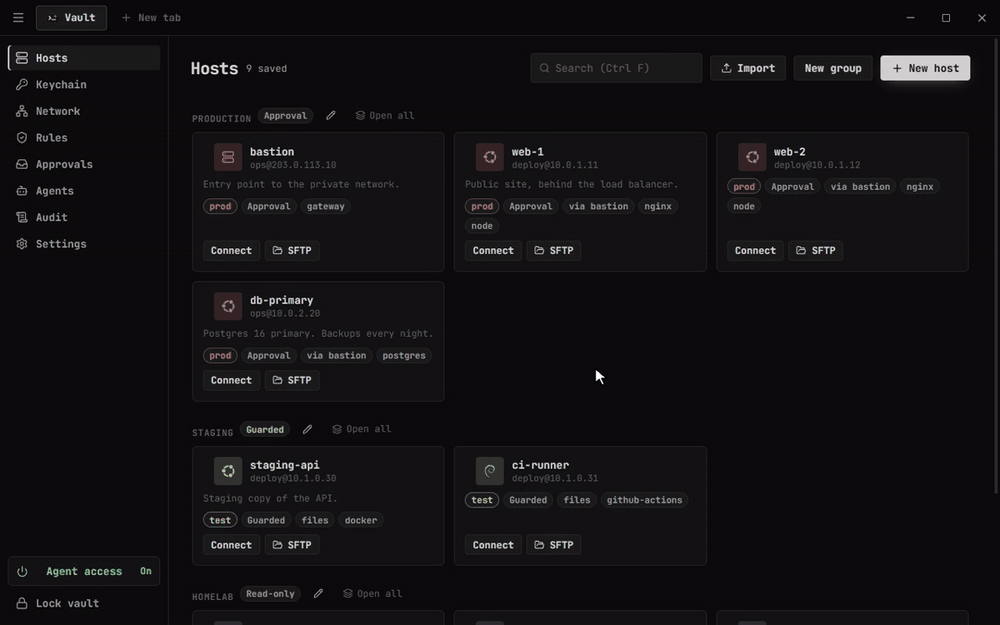

# Ethereon

[](https://github.com/MartinSchubert04/Ethereon/actions/workflows/desktop.yml)
[](https://github.com/MartinSchubert04/Ethereon/releases/latest)
[](https://github.com/MartinSchubert04/Ethereon/releases)


A Termius-style SSH manager for Windows that also gives Claude Code access without handing it any
credential. It sits in the tray and is lightweight with the window closed.





<sub>The demo uses made-up data (Docker containers): no host, IP or credential is real.</sub>

- **Encrypted vault:** passwords, private keys (with passphrase), certificates, sudo passwords
  and tokens. AES-256-GCM with a key derived from the master password (Argon2id). Locks itself.
  Like Bitwarden, a stored secret can be shown or copied (user, password) after typing the master
  password (then 5 minutes of grace); copied secrets leave the clipboard after 30 s. The agent
  still never sees them.
- **Termius-style hosts:** groups, tags, environment (prod, test, dev), chained bastion
  jumps and a description the agent reads for context.
- **Built-in terminal:** double-click a host and a terminal opens in the app, with tabs. Also
  local terminals (PowerShell, CMD, WSL, Git Bash).
- **Serial console:** a host can be a switch, AP or router over a console cable (port, baud rate,
  8N1, prompt pattern, login and `enable` from the vault). The port can be **Automatic**: the USB
  console cable that is plugged in, even if Windows gives it another COM (Bluetooth and built-in ports
  are skipped). The terminal talks to the device raw, with **Break** like PuTTY, and the
  agent uses the same `run(host, command)`: Ethereon sends the command, reads up to the prompt, answers
  the `--More--` prompts and returns the masked output. When there is no prompt to wait for (booting,
  ROMMON, a login the host doesn't have), the agent follows the **live console** with `console_read` /
  `console_send` (text and keys like Enter, Ctrl C or Break): you and the agent see the same screen.
  The read-only rules ship with a base list for network gear (`show`, `display`, `get`...).
- **Files:** this PC and the server side by side; files are transferred by dragging (also from
  Explorer), with progress and cancellation. Each host picks its protocol: SFTP (default), SCP
  (servers and devices without SFTP), FTP or FTPS.
- **TFTP server:** serves a folder so switches, routers and APs can download firmware or configs
  (`copy tftp: flash:`), optionally accepting uploads. In **Network**.
- **Connection test:** ping (average, min/max, jitter, loss, TTL), port and server banner, SSH login
  time, and a traceroute drawn as a tree with the latency of each hop; routers that are hosts in
  the vault show by name.
- **Network map:** traceroute to every host at once, merged into one tree where paths share routers.
- **For Claude Code (MCP):** `list_hosts` and `run(host, command)`, and on serial hosts
  `console_read` / `console_send`. The agent sees names and descriptions, never IPs, port names or
  secrets. Output comes back with secrets covered by `***`. Typing into a live console follows the
  host's mode: read-only only reads, approval asks for everything except a lone Enter, and forbidden
  commands are refused in every mode.
  Optional per host or group (off by default): `download` and `upload` over SFTP, with the same
  rules; downloads come back as masked text and nothing containing a vault secret is uploaded.
- **sudo without exposing the password:** Ethereon writes it to the process's standard input.
- **Rules:** per host or group, in one of five modes: read-only, with approval, Guarded (everything
  except what's forbidden), Free (total freedom) or no agent. The forbidden list is applied to each
  part of the command (pipes, `;`, `$( )`, backticks, `sh -c`, `sudo`...). Choosing Free, or dragging a
  host into a group where the agent doesn't ask, requires confirmation.
- **Drag-and-drop groups:** hosts move from one group to another by dragging the card.
- **Approvals:** approve, reject, edit the command or allow a pattern for the rest of the
  session. Desktop notification.
- **Fingerprints:** the first connection asks to confirm the host's fingerprint; if it changes, it blocks and warns.
- **Audit:** every request with device, host, command, result and output hash, in a
  signed chain that detects if someone edits it. Search and CSV export.
- **Import and export:** import detects the format on its own: Ethereon backups and exports,
  `~/.ssh/config` (Termius's too), keys and Bitwarden. Exports to Ethereon, OpenSSH (what
  Termius imports), Bitwarden, CSV or an encrypted backup.
- **Themes:** Default, Warp, Poolsuite FM, Haze and Athanor (IBM VGA bitmap font and "pixel clay",
  like portfolio-athanor), each with several palettes (Nord, Dracula, Tokyo Night, Srcery, Solar
  Flare, Lavender, Vellum...).
- **Terminal:** copy and paste like in Windows Terminal (Ctrl C with a selection, Ctrl V, right-click,
  copy on select), all configurable in Settings, as is the font size. Pasting an image into Claude
  Code attaches it, like in Warp (in local shells and over SSH). Gray suggestions while typing in a
  local shell, from history and folders, like Warp (Tab accepts; can be turned off).
- **Like Termius:** top bar with tabs (Vault + one per terminal), "New tab" with a host
  search, and the window comes back with the same size and position.
- **Shortcuts:** Ctrl T new tab, Ctrl W close (Ctrl Shift W inside a terminal), Ctrl Tab /
  Ctrl Shift Tab, Ctrl 1…9, Ctrl B sidebar, Ctrl F search, Ctrl , settings, Ctrl Shift L lock,
  Ctrl Shift C / V in the terminal. They can be reassigned in Settings → Keyboard shortcuts.

## Connecting Claude Code

In **Agents → Connect Claude Code** a token is created and Ethereon shows the command to paste:

```
claude mcp add --transport http --scope user ethereon http://127.0.0.1:47321/mcp --header "Authorization: Bearer eth_..."
```

The token is shown only once; Ethereon stores only its hash. It can be revoked instantly, and the
**Agent access** button in the sidebar (or the tray) cuts all access at once.

## How it's built

| Folder | What it is |
|---|---|
| `crates/ethereon-core/` | The broker, without a UI: vault, SSH, rules, masking, audit and MCP server. It's what will run on its own on a server in stage 3 |
| `apps/desktop/src-tauri/` | The app (Rust, Tauri 2): hosts the broker, the tray and the terminal |
| `apps/desktop/src/` | The interface (Svelte 5). Closing the window destroys the entire WebView |
| `docs/PLAN.md` | Stages, what's missing and why each thing was chosen |
| `docs/spec.md` | The original spec |
| `docs/SHORTCUTS.md` | All keyboard shortcuts and conveniences (terminal, SFTP, forms) |

## Development

Requires Rust (with the Visual Studio Build Tools) and Node 22 or newer.

```
npm install
npm run dev            # the app with live reload
npm run check          # interface types
cargo test             # core tests
```

Acceptance tests against real SSH servers (needs Docker):

```
bash crates/ethereon-core/tests/ssh-fixture/up.sh /tmp/ethereon-fixture
ETHEREON_TEST_KEY=/tmp/ethereon-fixture/key cargo test -p ethereon-core --test acceptance -- --ignored --nocapture
bash crates/ethereon-core/tests/ssh-fixture/down.sh
```

To test without touching the real vault:

- `ETHEREON_DATA_DIR=<folder>` uses a different data folder.
- `ETHEREON_PORT=<port>` changes the MCP port (47321 by default, or whatever `config.json` says).

Data lives in `%APPDATA%\app.ethereon.ssh`: `vault.json` (encrypted), `audit.jsonl` and `config.json`
(port and window position).

## Publishing a version

```
git tag v0.2.0
git push origin v0.2.0
```

The tag triggers `.github/workflows/desktop.yml`: it builds the installer, signs it and publishes it to the
Release along with `latest.json`. Installed apps check that file a minute after starting and then every 5
minutes (changeable in Settings → Startup and updates), download the new version in the background and install it on their own when the window is closed, the vault
locked and no agent commands are running (updating restarts the app and the vault ends up
locked). If that doesn't happen, **Update** appears in the top bar.

Signing uses the key at `~/.tauri/ethereon.key` (outside the repo), loaded into the repo's
`TAURI_SIGNING_PRIVATE_KEY` secret. **It must be kept somewhere safe:** if it's lost, installed
apps stop accepting updates and have to be reinstalled by hand. The public key is in
`tauri.conf.json`.
